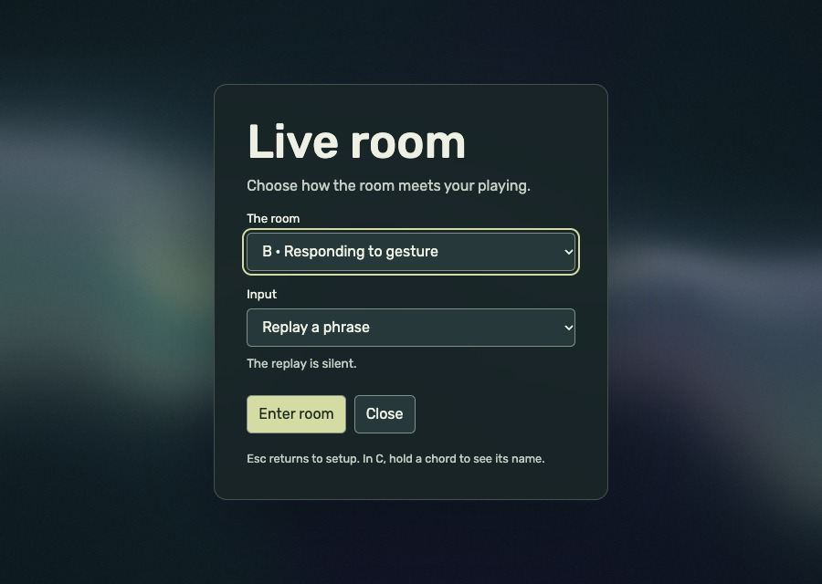
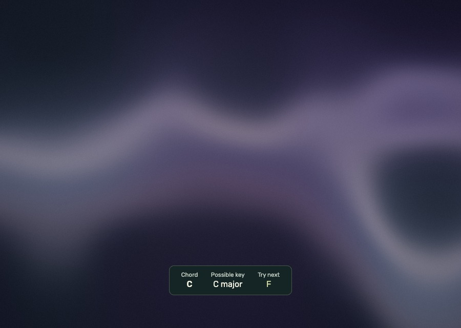
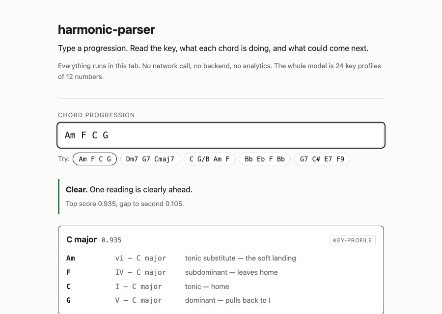

# Harmonic Parser design system

This reference describes the live room and chord parser as of 11 November 2026. The live room at `/room/` is a full viewport playing space. The chord parser at `/` is a reading and editing surface. Each entry point owns its stylesheet. The parser defines CSS custom properties, and the room defines its values in CSS and the field shader.

## Live room

### Layout and grid

| Region | Current layout |
| --- | --- |
| Field | A fixed canvas fills the viewport behind the UI. The room has a minimum height of `100svh` and its own stacking context. The canvas ignores pointer events. |
| Setup | A CSS grid centers a single panel with a `1rem` viewport gutter. The panel is `min(100%, 27rem)` wide including padding. Its internal padding is `clamp(1.3rem, 5vw, 2.2rem)`. |
| Setup form | A single column grid uses a `.5rem` gap. The MIDI group uses a `.6rem` gap. The action row uses flex with a `.55rem` gap and wraps on narrow screens. |
| Harmony readout | A fixed row centered horizontally at `max(10vh, env(safe-area-inset-bottom))` from the bottom. Width follows its content up to `calc(100% - 1.5rem)`. Items wrap with a `.55rem` row gap and a `clamp(.8rem, 4vw, 1.6rem)` column gap. |
| Reflection | A fixed message centered at `max(12vh, env(safe-area-inset-bottom))` from the bottom. It uses content width up to `calc(100% - 4rem)`. |
| Setup shortcut | The keyboard focusable **Room setup** button is placed `.75rem` from the top and left. It becomes visible on focus. |

At a 900 px viewport width, the setup panel measured 432 px across. At 360 px, it measured 328 px. The room uses fluid widths and wrapping for both sizes. [Layout CSS](../src/room/room.css) · [Field CSS](../src/room/visual/field.css)

### Color and surface values

Eight-digit hex values include alpha. The translucent panels pick up some of the field color behind them.

| Role | Value | Where it appears |
| --- | --- | --- |
| Background | `#121D22` | Page background and base of the CSS field |
| Main text | `#EEF0E3` | Inherited room text |
| Secondary text | `#C3CEC2` | Setup copy, status and harmony labels |
| Setup panel | `#182427F5` | Centered panel |
| Setup border | `#9AA89057` | Panel outline |
| Setup shadow | `0 1rem 5rem #0A12178C` | Panel separation from the field |
| Standard control | `#26383A` fill, `#EFF2E5` text, `#809187` border | Buttons and native selects |
| Primary action | `#D5DCA3` fill, `#1D2821` text | Enter room |
| Accent | `#D5DCA3` | Keyboard focus outline and suggested chord |
| Harmony surface | `#152524EB` | Chord, key and suggestion readout |
| Reflection surface | `#152524E6` | One sentence reflection |
| Overlay text and border | `#F1F0E0` text, `#AEB69B55` border | Harmony readout and reflection |

Controls have a `.35rem` radius, a `2.65rem` minimum height and `.4rem .75rem` padding. The setup panel, harmony readout and reflection use radii of `.9rem`, `.6rem` and `.5rem`, respectively. The disabled button opacity is `.55`. [Room CSS](../src/room/room.css)

### Typography

The room uses a locally served [Rubik](https://fonts.google.com/specimen/Rubik) variable font. Its fallback stack is Helvetica Neue, Helvetica, Arial and generic sans serif.

| Role | Family and size |
| --- | --- |
| Setup title | Rubik 500, `clamp(2.25rem, 8vw, 3.2rem)` at `1.1` line height |
| Setup body and controls | Rubik 400. Body paragraphs use `1.5` line height. Controls inherit the base size. |
| Setup labels | Rubik 400, `.83rem` |
| Input note and MIDI status | Rubik 400, `.85rem` |
| Setup footnote | Rubik 400, `.8rem` |
| Harmony labels | Rubik 400, `.72rem` |
| Harmony values | Rubik 400, `1rem` at `1.2` line height. The current chord uses weight 500 at `1.35rem`. |
| Reflection | Rubik 400, `clamp(.95rem, 3vw, 1.15rem)` at `1.4` line height |

### Components and states

| Component | Anatomy and behavior |
| --- | --- |
| Setup panel | **The room** selects A, B or C. **Input** selects phrase replay, chord progression replay or keyboard. **Enter room** starts the selected experience. **Close** returns to the ambient field. Setup opens from `?setup=1`, **Esc** or the keyboard focusable shortcut. Opening it focuses the condition selector. |
| MIDI controls | **Connect MIDI** requests access. The device selector appears when ports are available. A single port can be selected automatically. With several ports, choose one before entering. MIDI status text covers opening, readiness, unsupported browser, permission denied, no device, disconnect and a port that fails to open. Enter room is enabled when the selected keyboard is ready, or when using replay. A disconnect during play returns to setup. |
| Ambient field | A drifts on its own. B reacts to gestures. C uses the same gesture response and can show harmony or a reflection. The field stays visible behind setup and the readout. |
| Harmony readout | A definition list in C with **Chord**, **Possible key** and **Try next**. The chord is the primary value. The next chord uses the accent color. Each optional item appears when a value is available. The readout clears when the latest chord ages out. |
| Reflection | A single sentence in a polite status region. The motif replay can trigger it in C, and **R** can trigger it in a live MIDI session in C. While a reflection is visible, it occupies the overlay area. |

The setup uses native labels, selects and buttons. Room controls receive a `2px` accent outline with a `3px` offset on keyboard focus. MIDI and setup status messages use status regions. Harmony uses labeled values that can be read without relying on color. [Room markup](../room/index.html) · [Room states](../src/room/main.ts)

### Field palette and motion

The field uses two scales of continuous 3D noise to move its folds and tint. The shader mixes the following base colors in normalized RGB. The playing response blends violet and amber into these same layers.

| Shader color | RGB values |
| --- | --- |
| Ink | `(0.065, 0.080, 0.145)` to `(0.056, 0.130, 0.137)` |
| Mineral | `(0.23, 0.27, 0.41)` to `(0.29, 0.51, 0.46)` |
| Pearl | `(0.66, 0.67, 0.80)` to `(0.85, 0.78, 0.59)` |
| Rust | `(0.42, 0.25, 0.20)` |

| Interaction | Current value or response |
| --- | --- |
| Idle motion | Two noise layers drift along separate paths through a 3D field with quintic interpolation. The drift has its own clock and keeps its phase between setup and play. |
| Strike and held notes | Strike velocity controls the local impulse, with a `320ms` exponential decay time constant. The latest note's register positions the response. Physically held and pedal held notes contribute to the envelope, which saturates at four notes. All three values ease toward changes. |
| Activity | Frequent or stronger attacks gradually deepen the field toward violet. Attacks within `55ms` share one onset, weighted by its strongest note. |
| Release | After at least three onsets, a gap longer than the recent pace brings in amber. A recognized dominant resolution adds a stronger amber shift. Both fade over several seconds. |
| Reduced Motion | The field holds its current drift phase. Playing can still change its color, with less displacement. |
| WebGL fallback | A static CSS field uses two radial gradients and a linear gradient. It appears when the canvas is unavailable or loses its context. |
| Chord timing | A recognizable voicing settles after `125ms`. Its readout can linger for `700ms` after the voicing changes or releases. The possible key uses up to 12 recently accepted chords in a 12 second window and requires at least three distinct chords. |
| Reflection timing | `2100ms` for the current motif replay cue and the facilitator cue. |

[Motion controls and investigation](field-motion.md) · [Field shader](../src/room/visual/renderer.ts) · [Palette timing](../src/room/analysis/mood.ts) · [Gesture and reflection timing](../src/room/session.ts) · [Harmony timing](../src/room/analysis/live.ts)

## Chord parser

### Layout and grid

The page has one centered reading column, capped at `44rem` including `1.25rem` horizontal padding on each side. Top and bottom padding are `2.5rem` and `4rem`. The header, input, examples, analysis and footer follow the document flow.

| Region | Current layout |
| --- | --- |
| Examples and pins | Wrapping flex rows. Example buttons use a `.4rem` gap. The pin bar uses a `.5rem` gap. |
| Readings | A vertical grid with a `1rem` gap. Each card uses `.9rem 1rem` padding and an `8px` radius. |
| Reading header | Baseline aligned flex row for key, score and source. The source sits at the trailing edge. |
| Chord function table | Full card width. Columns contain chord, numeral and role. Chord and numeral columns each request `6rem`. |
| Suggestions | Vertical list with a `.3rem` row gap. The chord and its reason sit in a baseline aligned row with a `.75rem` gap. |

Chrome measured the outer column at 704 px on a 900 px viewport. The captured progression fit a 360 px viewport without horizontal document scrolling. [Parser layout CSS](../src/style.css)

### CSS tokens

The parser follows the system color scheme. Its `:root` values define the light palette and `prefers-color-scheme: dark` overrides the color values.

| Token | Light | Dark | Role |
| --- | --- | --- | --- |
| `--bg` | `#FBFBF9` | `#17181A` | Page background |
| `--fg` | `#1B1B1A` | `#ECECEB` | Primary text, leading reading border and input focus |
| `--muted` | `#6A6A66` | `#9A9A96` | Supporting copy, labels and scores |
| `--line` | `#DEDEDA` | `#2E3033` | Dividers and neutral borders |
| `--card` | `#FFFFFF` | `#1E2022` | Reading cards, input and example buttons |
| `--clear` | `#2F7D4F` | `#7BC79A` | Clear confidence notice |
| `--ambiguous` | `#9A6B13` | `#E0B256` | Ambiguity notice, chromatic numerals and pin indicators |
| `--uncertain` | `#A33A2A` | `#E88A78` | Uncertainty, unreadable tokens and pin conflict |

The body uses system sans serif at `16px/1.55`. The page title is `1.6rem`, reading titles are `1.05rem`, and supporting copy is typically `.85rem`. The `--mono` stack is `ui-monospace, SFMono-Regular, Menlo, Consolas, monospace`. It is used for chord input and symbols, Roman numerals, scores and example buttons. [Parser tokens and typography](../src/style.css)

### Components and states

| Component | Anatomy and behavior |
| --- | --- |
| Progression input | A visible label sits above a full width single line text field. It uses `1.15rem/1.3` monospace, a `6px` radius and a `2px` foreground focus outline with a `1px` offset. |
| Example buttons | Pill shaped buttons insert a progression and return focus to the input. The examples include clear, ambiguous and uncertain results. |
| Notice | A `3px` left rail paired with a text label and explanatory copy. The states include **Clear**, **Musical ambiguity**, **Model uncertainty**, unreadable tokens and conflicting pins. |
| Reading card | A key, score and source label above a chord function table. The leading card gets a stronger border when the reading is sufficiently supported. Uncertain readings have dashed borders and `.72` opacity, with scores using the uncertainty color. |
| Pin control | A native select in the leading card's numeral column. Its accessible label identifies the chord. Pinned values get an amber outline and a **pinned** marker. The pin bar summarizes active constraints and provides a clear button. |
| Suggestions | Chord symbols with a short reason for each. In the uncertainty state the section shows **No suggestions** and the reason. |
| Empty result and feedback | The empty state prompts for a progression. The footer gives the current confidence caveat and links to the source and feedback. |

Results update as the user types. A separate visually hidden polite status region announces a summary after a `500ms` pause. [Parser markup](../index.html) · [Result components](../src/ui.ts) · [Announcement timing](../src/announce.ts)

## Inspect the current UI

Run `npm ci` and `npm run dev`, then use the port Vite prints. Open `/` and select **Am F C G** for the parser view shown above. Open `/room/?setup=1` for setup. To see the readout, choose **C · Gesture and harmony → Replay a chord progression → Enter room**. The screenshot was taken on the final C chord. [Playing guide](live-room-poc.md)
